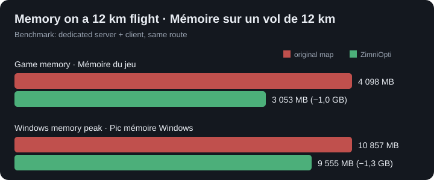

# Research log · Journal de recherche

Every finding is a card in [OPTI_MEMOIRE.md](OPTI_MEMOIRE.md) (French): observation, cause, idea, test, measured result.
Chaque trouvaille est une fiche de [OPTI_MEMOIRE.md](OPTI_MEMOIRE.md) : constat, cause, piste, test, résultat mesuré.

**Legend · Légende** : ✅ applied / appliqué · ❌ no gain / sans gain · ⚠️ pitfall / piège · ⭐ key finding / découverte clé · 🔎 investigation / analyse

| Card | | Title (FR) |
|---|---|---|
| F1 | ✅ | Les textures 4096 pèsent ~2,4 Gio de VRAM — appliqué, −0,7 Go VRAM mesuré (rendu en jeu à confirmer) |
| F2 | 🔎 | Les villes coûtent cher, la campagne rien |
| F5 | ✅ | Distance de vue — LEVIER N°1 (mesuré 2026-11-09) |
| F4 | 🔎 | Prefabs propres à Zimnitrita : ni LOD, ni occluder, ni distance max — cible n°1 |
| F6 | ❌ | AutoOccluders du terrain — sans effet (2026-11-09) |
| F7 | 🔎 | Recensement des entités de la carte — (2026-11-09) |
| F8 | ❌ | Réglages graphiques moteur (ombres, détail…) — quasi sans effet sur PC (2026-11-09) |
| F3 | 🔎 | Pics à 200 ms (saccades) |
| F9 | 🔎 | Éjections « REPLICATION FLOODED » + 247k entités statiques répliquées (2026-11-09) |
| F10 | ❌ | Masquage d'objets (« culling »/chunks) — sans gain sur PC (2026-11-09) |
| F11 | 🔎 | Zimnitrita vs cartes Bohemia (2026-11-09, sous-agent, parseur EBIN maison) |
| F12 | ❌ | Buissons −50 % (471k retirés, `zimni_thin_bushes.py`) — sans gain PC (2026-11-09) |
| F13 | ⭐ | La console PLANTE (mémoire), elle ne rame pas — mesure = `memoireMo` du banc (2026-11-09) |
| F13 suite | 🔎 | tour de carte (20 zones, ~30 min, buissons 1/3 + rochers 1/2) |
| F14 | 🔎 | mémoire détaillée (MemoryStatsSnapshot) + streaming IA de FF |
| F15 | ❌ | Mode chunk (suppression réelle des décors loin du joueur) — gain mémoire faible (2026-11-09) |
| F16 | ⭐ | Everon sur le même banc : 1,6-1,9 Go contre 4,0-4,1 Go (2026-11-09) |
| F17 | ✅ | Chunk végétation (« chunktrees », rayon 1600 m) — −500 Mo (2026-11-09) |
| F18 | ✅ | Chunk végétation : purge au chargement + ordre de suppression — ≈ −800 Mo (2026-11-10, nuit) |
| F19 | 🔎 | VRAM : l'allocateur garde son maximum (relevé de Girbev, overlay DX12 Workbench, 2026-11-10) |
| F19 suite | 🔎 | parcours de Girbev refait en jeu client (banc, 2026-11-10) |
| F20 | ✅ | Chunk étendu « chunkall » : végétation + petits objets extérieurs — −270 Mo de plus (2026-11-10) |
| F21 | ⚠️ | Les chunks libèrent la mémoire DANS le jeu, pas pour le système (2026-11-10 soir) |
| F22 | ✅ | Prototype « apparition à la demande » (ZO_Streamer) — ≈ −1 Go RÉEL (2026-11-11, nuit) |
| F23 | ⚠️ | Éjections « REPLICATION FLOODED » : gel du client après un saut de position (2026-11-11, 02:40) |
| F22 suite | 🔎 | Plan B des tuiles : ressources .conf au lieu de fichiers lus à la main (2026-11-16) |
| F24 | 🔎 | Éclaircissement (buissons 1/3, rochers 1/2) SEULEMENT sur console (préparé hors ligne, 2026-11-16) |
| F23 résultat | 🔎 | A/B « flooded » (2026-11-16) |
| F25 | 🔎 | Banc « vol de caméra » et saccades du streamer (2026-11-16) |
| F24 résultat | 🔎 | éclaircissement console seulement (2026-11-16) |
| F26 | 🔎 | Overrides de bâtiments dans Zimnitrita : coût (2026-11-16) |
| F27 | ❌ | Lumières (piste F11) — sans gain (2026-11-16) |
| F28 | 🔎 | Rayon de streaming console (vue plafonnée 1 200 m) (2026-11-16) |
| F29 | ❌ | Herbe et petits objets sur le vol (console simulée, rayon adaptatif) — (2026-11-16) |
| F30 | 🔎 | Au sol vs en l'air (2026-11-16) |
| F31 | ❌ | À pied : distance de vue et intérieurs (2026-11-17) — faible |
| F32 | 🔎 | Ombres à pied (2026-11-17) — ~ petit gain |
| F33 | ❌ | Textures bâtiments 2048 → 1024 (78 textures, ~306 Mo max) — annulé (2026-11-17) |
| F34 | 🔎 | Journal inondé par les objets cassables créés par le streamer (2026-11-17) — piste |
| F35 | ❌ | Tuiles terrain (couleur + relief) 512 → 256 — (2026-11-17) |
| F36 | ⚠️ | Les objets créés par le streamer sont INCASSABLES (version publiée) (2026-11-17) |

Raw benchmark outputs (`*.txt`, `*.csv`, heatmaps `*.png`) are in this folder, one file per A/B test.
Les résultats bruts du banc (`*.txt`, `*.csv`, cartes de chaleur `*.png`) sont dans ce dossier, un fichier par test A/B.
